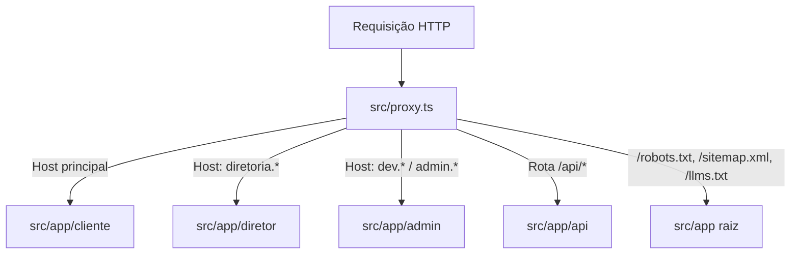

<div align="center">

# Cinética

### Site oficial da Atlética Cinética (A.A.A.F.A. Fisioterapia): loja oficial, sorteios online e ingressos

[-000000?style=for-the-badge&logo=nextdotjs&logoColor=white)](https://nextjs.org/)
[](https://react.dev/)
[](https://www.typescriptlang.org/)
[](https://tailwindcss.com/)
[](https://supabase.com/)
[](https://www.mercadopago.com.br/)
[](https://vitest.dev/)
[](LICENSE)

<p align="center">
  <b>Loja de produtos oficiais e sorteios online da atlética, com venda de ingressos para eventos.</b><br>
  Pagamentos via Pix e cartão pelo Mercado Pago, bilhetes de sorteio gerados após o pagamento e ingressos com QR Code antifraude.
</p>


---

</div>

## Visão Geral

O site da **Atlética Cinética** é a plataforma oficial da atlética em Palmas/TO. As frentes, em ordem de prioridade:

| Frente | Papel | O que oferece |
| :--- | :--- | :--- |
| **Loja oficial** | Principal | Camisetas, kits e produtos da atlética, com carrinho, tamanhos, pagamento online e retirada com a diretoria. |
| **Sorteios online** | Principal | Cotas pagas via Pix (ou gratuitas), números de bilhete gerados automaticamente e resultado publicado na plataforma. |
| **Ingressos para eventos** | Secundário | Festas e eventos de atléticas parceiras, com lotes, QR Code pessoal e validação na portaria. |

O projeto se divide em três portais: o do cliente, o da diretoria da atlética e o da administração geral.

---

## Funcionalidades

### 1. Portal do Cliente

**Loja oficial** (`/loja`)
* Vitrine com busca, página de produto com variações de tamanho e carrinho salvo no navegador.
* Checkout por **Pix** (QR Code / Copia e Cola) ou **cartão de crédito** via Mercado Pago.
* **Meus pedidos** com status do pagamento e da retirada (`Pago • Aguardando retirada` → `Entregue`).

**Sorteios online** (`/sorteios`)
* Vitrine com filtros (rolando agora, em breve, resultados), barra de progresso das cotas e regulamento de cada sorteio.
* Compra de cotas via **Pix**. Os bilhetes só são criados depois da aprovação do pagamento.
* Sorteios gratuitos limitados a **1 cota por conta**.
* **Meus bilhetes** com os números de cada sorteio, e divulgação do ganhador (nome, bilhete premiado e cidade).

**Ingressos** (`/eventos`, `/atleticas`)
* Catálogo de eventos e atléticas parceiras, com mapa de localização (Leaflet) e lotes ativos.
* Ingresso digital com **QR Code assinado** e download em PDF (`jspdf` + `qrcode`).

**Conta e institucional**
* Cadastro, login e recuperação de senha, perfil com foto em **Minha conta**.
* Páginas **Sobre** (`/sobre`) e **Termos & Privacidade** (`/termos-e-privacidade`), com Termos de Uso, Política de Privacidade (LGPD) e Política de Cookies. Um link como `#cookies` abre direto na aba.
* Banner de consentimento de cookies com as opções *Aceitar todos*, *Só essenciais* e *Personalizar*. As categorias não essenciais começam **desligadas**.

### 2. Portal da Diretoria da Atlética
* **Produtos e pedidos da loja:** cadastro de produtos e estoque, métricas de vendas e registro de entrega dos pedidos pagos.
* **Sorteios:** criação e edição de sorteios (prêmios, cotas, data e forma de apuração, regulamento) e registro do ganhador.
* **Eventos e lotes:** criação de eventos, lotes progressivos com estoque e virada de lote, relatório de vendas e cancelamento de ingressos.
* **Validação de entrada:** scanner de QR Code no navegador (`html5-qrcode`), que funciona na câmera de qualquer celular, sem precisar de app.
* **Atlética:** dados públicos da atlética (contatos, WhatsApp, redes sociais).

### 3. Portal de Administração Geral
* Aprovação e gestão de atléticas e solicitações de diretoria.
* Gestão de usuários e papéis (cliente, diretor, admin).
* Visão consolidada de eventos e relatórios financeiros, e reconciliação de pagamentos.

---

## Roteamento dos Portais

O `src/proxy.ts` (antigo middleware) decide qual portal atender. Há dois modos:

* **Por caminho (padrão, sem configuração):** tudo no mesmo domínio. Painel da diretoria em `/diretor` e administração em `/admin`.
* **Por subdomínio:** quando `NEXT_PUBLIC_DOMINIO_PRINCIPAL`, `NEXT_PUBLIC_SUBDOMINIO_DIRETORIA` e `NEXT_PUBLIC_SUBDOMINIO_DEV` estão preenchidos.

| Portal | Modo caminho | Modo subdomínio (exemplo) | Rota interna no App Router |
| :--- | :--- | :--- | :--- |
| **Cliente** | `/` | `seudominio.com.br` | `src/app/cliente` |
| **Diretoria** | `/diretor` | `diretoria.seudominio.com.br` | `src/app/diretor` |
| **Administração** | `/admin` | `dev.seudominio.com.br` | `src/app/admin` |



> **Notas:**
> * Os nomes dos subdomínios são configuráveis pelas variáveis de ambiente acima.
> * `/robots.txt`, `/sitemap.xml` e `/llms.txt` são gerados na raiz do app (`robots.ts`, `sitemap.ts`, `llms.txt/route.ts`) e o proxy os entrega **sem reescrita** para `/cliente`. Se você criar outro arquivo desse tipo na raiz, inclua-o em `ARQUIVOS_RAIZ_PUBLICOS`.

---

## Pagamentos

Todos os fluxos usam o **Mercado Pago**, e a confirmação chega pelo webhook único `/api/webhook-mercadopago`.

| Fluxo | Rotas | Métodos |
| :--- | :--- | :--- |
| Loja | `/api/loja/pagamentos/{pix,card,gratuito}` | Pix, cartão e pedido gratuito |
| Sorteios | `/api/sorteios/{pix,gratuito}` | Pix e cota gratuita |
| Ingressos | `/api/payments/{pix,card,gratuito}` | Pix, cartão e ingresso gratuito |

Duas tarefas agendadas (cron) mantêm a consistência: `/api/cron/expirar-pedidos` expira pedidos não pagos e libera estoque e cotas, e `/api/cron/reconciliar-pedidos` reconcilia com o gateway pagamentos aprovados que não chegaram pelo webhook. As duas são protegidas por `CRON_SECRET`.

---

## Segurança e Antifraude

* **QR Code com assinatura HMAC:** os ingressos geram tokens assinados para impedir clonagem, falsificação e reutilização após o check-in.
* **Row Level Security (RLS):** todas as tabelas do Supabase isolam os dados por usuário e por atlética. Cada cliente vê apenas os próprios pedidos, bilhetes e ingressos.
* **Bilhetes só após pagamento:** os números de sorteio são criados no servidor depois da aprovação, sem reserva para pedidos pendentes.
* **Headers de segurança:** *Content-Security-Policy* (CSP), *HSTS*, *X-Frame-Options: DENY* e *Permissions-Policy*.
* **Proteção contra bots:** **Cloudflare Turnstile** no checkout e na autenticação, além de limite de tentativas no login.
* **Webhooks validados:** verificação de assinatura, idempotência e conciliação dos eventos de pagamento.

O relatório detalhado está em [`docs/RELATORIO_AUDITORIA_SEGURANCA.md`](docs/RELATORIO_AUDITORIA_SEGURANCA.md).

---

## Stack Técnica

| Camada | Tecnologias |
| :--- | :--- |
| **Frontend** | [Next.js 16 (App Router)](https://nextjs.org/), [React 19](https://react.dev/), [TypeScript](https://www.typescriptlang.org/), [Tailwind CSS v4](https://tailwindcss.com/), [Lucide React](https://lucide.dev/) |
| **Backend & Banco de Dados** | [Supabase](https://supabase.com/) (PostgreSQL, Auth, Storage, Row Level Security, Realtime) |
| **Pagamentos** | [Mercado Pago](https://www.mercadopago.com.br/) (Pix dinâmico e cartão de crédito) |
| **Leitura & Documentos** | `html5-qrcode` (scanner de câmera no navegador), `jspdf`, `qrcode`, `leaflet` |
| **Proteção contra bots** | `@marsidev/react-turnstile` (Cloudflare Turnstile) |
| **Qualidade & Testes** | [Vitest](https://vitest.dev/), ESLint, TypeScript em modo estrito |

---

## Como Rodar Localmente

```bash
npm install
npm run dev      # http://localhost:3000
```

### Banco de dados

As migrações ficam em `supabase/migracoes/` e devem ser aplicadas em ordem numérica. O arquivo `supabase/schema_unificado.sql` reúne o esquema completo para criar um banco do zero. Os módulos de loja (`029`+) e sorteios (`033`, `034`, `036`) dependem das migrações correspondentes.

### Variáveis de ambiente (`.env.local`)

| Variável | Uso |
| :--- | :--- |
| `NEXT_PUBLIC_SUPABASE_URL`, `NEXT_PUBLIC_SUPABASE_ANON_KEY` | Conexão pública com o Supabase |
| `SUPABASE_SERVICE_ROLE_KEY` | Operações de servidor (webhooks, crons, sitemap). **Nunca exponha no cliente.** |
| `MERCADOPAGO_ACCESS_TOKEN`, `NEXT_PUBLIC_MERCADOPAGO_PUBLIC_KEY`, `MERCADOPAGO_WEBHOOK_SECRET` | Pagamentos e validação do webhook |
| `QR_CODE_SECRET` | Chave HMAC dos QR Codes dos ingressos |
| `NEXT_PUBLIC_CLOUDFLARE_TURNSTILE_SITE_KEY`, `CLOUDFLARE_TURNSTILE_SECRET_KEY` | Proteção contra bots |
| `CRON_SECRET` | Autenticação das rotas de cron |
| `TEST_SUITE_SECRET` | Protege a rota de teste de fluxo de pagamento |
| `NEXT_PUBLIC_DOMINIO_PRINCIPAL`, `NEXT_PUBLIC_SUBDOMINIO_DIRETORIA`, `NEXT_PUBLIC_SUBDOMINIO_DEV`, `NEXT_PUBLIC_DOMINIO_COOKIE`, `NEXT_PUBLIC_PROTOCOLO` | Roteamento por subdomínio (opcional) |
| `NEXT_PUBLIC_EMAIL_SUPORTE` | E-mail exibido na Central de ajuda (vazio = oculto) |
| `NEXT_PUBLIC_GOOGLE_MAPS_API_KEY` | Mapas dos eventos (opcional) |

---

## SEO

* Metadados globais em `src/app/layout.tsx`, com foco em loja oficial e sorteios.
* `sitemap.xml` com as páginas principais (`/loja` e `/sorteios` com prioridade mais alta, depois `/eventos`) e os eventos publicados.
* `robots.txt` bloqueia as áreas privadas (conta, bilhetes, ingressos, carrinho, checkout, pedidos e painéis) para todos os robôs, inclusive os de IA.
* `llms.txt` com um resumo da plataforma para buscadores de IA.
* Dados estruturados (JSON-LD de organização e FAQ) na página Sobre.

---

## Testes Automatizados

O projeto usa **Vitest** para testar as rotas de pagamento, os sorteios, o SEO, a segurança e as funções utilitárias:

```bash
npm run test        # todos os testes
npm run test:watch  # modo watch
npm run lint        # ESLint
```

---

## Licença

Este projeto é disponibilizado sob a licença [MIT](LICENSE).

<div align="center">
  <sub>Desenvolvido pela e para a Atlética Cinética — loja, sorteios e eventos acadêmicos.</sub>
</div>
